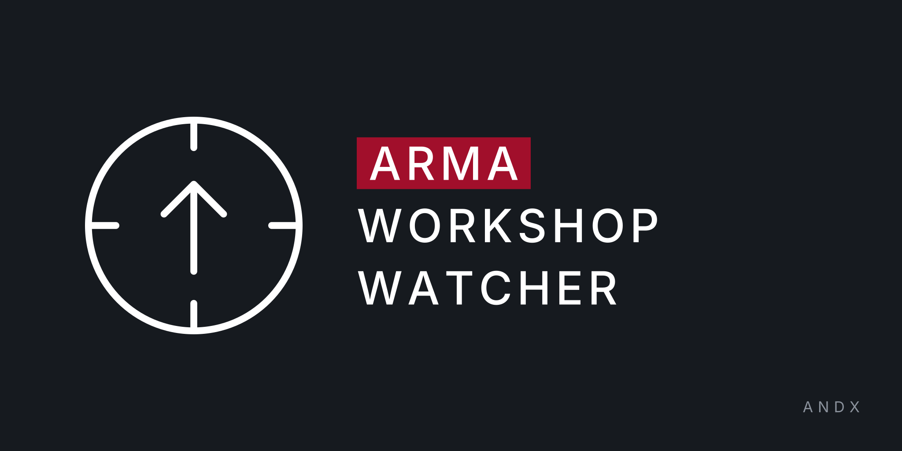

<p align="center">
  
</p>

# arma-workshop-watch

[](https://github.com/Andx667/arma-workshop-watch/actions/workflows/build.yml)
[](https://github.com/Andx667/arma-workshop-watch/pkgs/container/arma-workshop-watch)

[](https://github.com/Rapptz/discord.py)


A Discord bot that posts a message when a watched Steam Workshop item is updated. Built for Arma 3 mods, but it works for any game's Workshop.

Each notification has the mod title, thumbnail, update time, a link, and the newest changelog entry when Steam's changelog page can be read.

## Commands

All commands need the *Manage Server* permission by default (adjustable in Server Settings → Integrations).

| Command | What it does |
| --- | --- |
| `/watch channel <#channel>` | Where updates are posted (one channel per server) |
| `/watch import <file>` | Attach an Arma 3 Launcher preset export (`.html`) and watch every Steam Workshop mod in it. Local mods are skipped. Update notifications then name the preset(s) the mod came from |
| `/watch add <link or id>` | Start watching a mod. The current state is the baseline, so no message is sent for the mod's existing version |
| `/watch remove <mod>` | Stop watching (autocompletes) |
| `/watch list` | Show watched mods |

If a mod is removed or hidden on Steam, the bot posts one warning and keeps watching.

## How it works

Every `POLL_INTERVAL_MINUTES` the bot asks the public Steam `GetPublishedFileDetails` endpoint (no API key) about all watched mods in one request and compares `time_updated`. The changelog text is scraped from the Workshop changelog page. That part is best effort: if Steam changes the page, notifications still go out, just without the note.

State lives in SQLite at `$DATA_DIR/bot.db`.

## Configuration

| Variable | Default | |
| --- | --- | --- |
| `DISCORD_TOKEN` | required | Bot token |
| `POLL_INTERVAL_MINUTES` | `10` | |
| `DATA_DIR` | `/data` | Must be persistent |
| `LOG_LEVEL` | `INFO` | |

## Discord setup

1. Create an application at the [Developer Portal](https://discord.com/developers/applications), add a bot, copy its token.
2. No privileged intents are needed.
3. Invite with scopes `bot` and `applications.commands`, and the permissions View Channel, Send Messages, Embed Links.

## Deploy on CapRover

CI publishes `ghcr.io/andx667/arma-workshop-watch:latest` on every push to `main`.

1. After the first CI run, open the package on GitHub (Packages → arma-workshop-watch → Package settings) and set the visibility to **public**, or add GHCR credentials under CapRover → Cluster → Docker Registry.
2. In CapRover create an app. Don't enable HTTP; the bot has no web interface.
3. App Configs: add the `DISCORD_TOKEN` environment variable. Add a **persistent directory** with path in app `/data`. Keep the instance count at 1.
4. Deployment tab → *Deploy via ImageName*: `ghcr.io/andx667/arma-workshop-watch:latest`.
5. Optional auto-redeploy: in the app's Deployment tab enable *Method 3: Deploy via webhook*, copy the URL, and store it as the repository secret `CAPROVER_WEBHOOK_URL`. CI then redeploys after each successful image build. For this to pull a new image, deploy once with the image name first.

## Local development

```
pip install -e ".[dev]"
pytest
DISCORD_TOKEN=... DATA_DIR=./data python -m bot
```

Or `cp .env.example .env` and `docker compose up --build`.

## License

[MIT](LICENSE)
